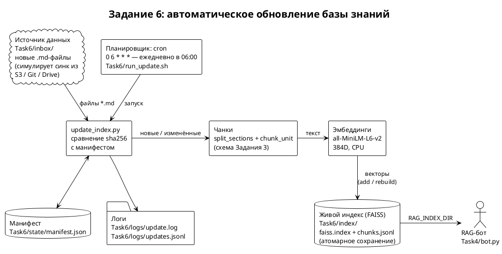

# Задание 6. Автоматическое ежедневное обновление базы знаний

1. Источник — папка `Task6/inbox/`: в неё появляются новые `.md`-файлы
   (симулирует синк из S3 / Git-репозитория / Drive — из любого
   источника). «Подхват» новых файлов — сканирование папки.
2. Скрипт `update_index.py`: сравнивает inbox с манифестом
   (`state/manifest.json`) по sha256; новые файлы чанкует
   (схема Задания 3: `split_sections` + `chunk_unit`) и пробегает
   тем же эмбеддером (all-MiniLM-L6-v2), изменённые — заменяет,
   удалённые — вычитает из индекса (пересборка из оставшихся векторов).
   Сохранение атомарное (tmp-файл + rename) — при сбое живая копия
   индекса не повреждается.
3. Планировщик — cron: `0 6 * * *` (ежедневно в 06:00), запуск через
   `run_update.sh` (ставит `RAG_INDEX_DIR`, cwd и venv).
4. Логи — `logs/update.log` (человекочитаемый) и `logs/updates.jsonl`
   (JSON, одна запись на запуск); stdout/stderr cron — `logs/cron.log`.
   (`update.log` и `cron.log` в .gitignore — `*.log`; в репо попадают
   `updates.jsonl`, `demo.txt` и отрывок `update.log` в этом README.)
5. Проверил на новом документе `Korvane.md`: добавление → изменение
   → повтор без изменений; бот отвечает на вопросы о новом контенте
   (транскрипт — `logs/demo.txt`).

## Как работает «подхват»

Скрипт сканирует `inbox/*.md` и сверяет sha256 каждого файла с
манифестом:

* файла нет в манифесте → чанки + эмбеддинги → добавить в индекс;
* хэш изменился → удалить старые чанки, добавить новые;
* хэш тот же → пропустить (скрипт идемпотентен, повторный запуск
  безопасен);
* файл в манифесте, но пропал из папки → удалить его чанки
  (индекс пересобирается из оставшихся векторов — IndexFlatIP
  векторы не удаляет, при нашем размере пересборка идёт секунды).

Манифест хранит по каждому файлу: хэш, id его чанков и время
обновления. Чанки новых документов получают id `<файл>#<n>` —
уникальные в пределах индекса.

## Запуск и поведение при ошибках

```bash
# первый запуск — индекс копируется из Задания 5
.venv/bin/python Task6/update_index.py --init-from Task5/index
# дальше — обычный запуск (именно так его вызывает cron)
.venv/bin/python Task6/update_index.py
```

Строка в crontab:

```
0 6 * * * /home/mgatin/IdeaProjects/ya/architecture-pro-rag/Task6/run_update.sh
```

Бот читает тот же индекс:
`RAG_INDEX_DIR=$PWD/Task6/index .venv/bin/python Task4/bot.py`.

Если на файле ошибка — она пишется в лог, остальные файлы
обрабатываются, exit code ненулевой → cron повторит завтра. Повтор
безопасен: манифест обновляется только после успешного сохранения,
а неизменённые файлы пропускаются, дублей не будет. Ошибки до старта
скрипта (нет venv, нет индекса) попадают в `logs/cron.log`.

## Проверка

`inbox/Korvane.md` — новая луна вселенной Aetherion (только
переименованные термины мира):

| запуск | что делали | результат |
|---|---|---|
| 1 | положили `Korvane.md` | 2 чанка, индекс 6925 → 6927 |
| 2 | добавили секцию «Vey Gate» | изменён → 3 чанка, старые удалены, индекс 6928 |
| 3 | без изменений | ничего не поменялось (идемпотентность) |

Ответы бота — `logs/demo.txt`: «Что такое Korvane?» (cos 0.432)
и «Что такое Vey Gate?» (cos 0.446) — обе выше порога 0.40 и
отвечены по новому документу. Мелкая деталь, которую поймал на
проверке: пока секция «Vey Gate» была короче 100 слов, она сливалась
в чанк истории и по запросу не находилась (cos 0.373, ниже порога) —
гранулярность чанков напрямую влияет на то, что находит поиск.

Отрывок лога (`logs/update.log`):

```
2026-10-08 00:37:51 новый: Korvane.md → 2 чанков
2026-10-08 00:37:54 index updated at 2026-10-08 00:37, 1 files added, 0 changed, 0 removed, 2 chunks added, index=6927 chunks, 0 errors
2026-10-08 00:39:49 изменён: Korvane.md → 3 чанков
2026-10-08 00:39:49 индекс пересобран: -2 чанков (осталось 6925)
2026-10-08 00:39:49 index updated at 2026-10-08 00:39, 0 files added, 1 changed, 0 removed, 3 chunks added, index=6928 chunks, 0 errors
2026-10-08 00:40:28 index updated at 2026-10-08 00:40, 0 files added, 0 changed, 0 removed, 0 chunks added, index=6928 chunks, 0 errors
```

## Архитектура

`architecture.puml` → `architecture.png`:


