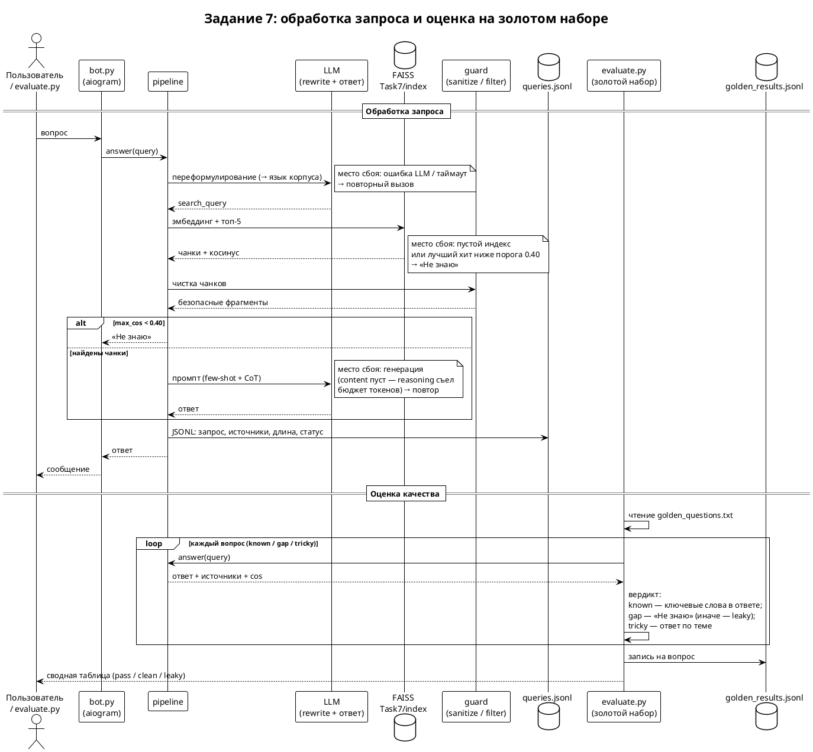

# Задание 7. Аналитика покрытия и качества базы знаний

1. Сделал «пробельный» индекс: `make_gap_index.py` удалил из живого
   индекса (Task6/index) все чанки с упоминаниями трёх ключевых
   сущностей — **Xarn Velgor** (персонаж), **Void Core** (супероружие),
   **Synth Flux** (базовый концепт). 6 928 → 3 954 чанка: ушло 2 289
   чанков с Synth Flux (концепт сквозной, как «Сила»), 751 с
   Xarn Velgor, 420 с Void Core. Результат — `Task7/index/`.
2. Добавил логирование запросов в пайплайн — `Task4/rag/querylog.py`:
   каждый запрос (бот, CLI, тест) пишет строку в JSONL
   (`RAG_QUERY_LOG`): timestamp, запрос, поисковый запрос, найдено
   ли что, лучший cos, источники, длина ответа, отказ, флаг
   «успешный ответ». Лог прогона — `logs/queries.jsonl`.
3. Собрал золотой набор — `golden_questions.txt`: 14 вопросов
   (8 known + 5 gap + 1 tricky). known и tricky подобраны по
   замера поиска по gap-индексу: у known-вопросов правильный
   источник в топе (cos 0.55–0.72), gap-вопросы — ниже порога
   0.40 (0.31–0.40).
4. Прогнал набор через полный пайплайн — `evaluate.py`: вердикты
   (known — ключевые слова в ответе; gap — «не знает», иначе
   «leaky»; tricky — ответ по теме). Итог: **known 8/8, gap 4/5
   clean + 1 leaky, tricky 1/1**. Детали — `logs/golden_results.jsonl`.
5. Проанализировал логи и покрытие — выводы ниже.

## Результаты теста

| тип | результат | комментарий |
|---|---|---|
| known (8) | 8/8 pass | все источники правильные (cos 0.56–0.72); у 4 вопросов из 8 полнота по ключевым словам 50% — ответ верный, но второй ожидаемый термин модель не употребила |
| gap (5) | 4 clean, 1 leaky | Void Core (×2), Synth Flux, Sith Code — честное «Не знаю» (top 0.31–0.40); **Xarn Velgor — протечка** (см. ниже) |
| tricky (1) | 1/1 pass | «История Korrath»: поиск дал нерелевантную статью (Ondara), но модель заметила, что фрагменты не отвечают, и отказалась честно |

**Leaky — «Кто такой Xarn Velgor?» (top 0.534).** Из статьи
Darth-Vader.md удалена половина чанков (762 → 373: выжившие не
называют персонажа — про «его сына», «ученика Theron Mal»,
«господина»), плюс безымянные фрагменты Anakin-Skywalker.md и
Emperor-Palpatine.md. Модель по ним реконструировала персонажа: «ученик Theron Mal, телекинез, поиск
Joren и Drayden, конфликт вокруг Vexa, получил мир Emberfall» — по
существу верно, хотя сущность формально удалена. Вывод: удаление
упоминаний не герметично — кросс-референсы в чужих статьях позволяют
восстановить значительную часть знаний об «удалённой» сущности.

**Мелкая деталь у порога.** «Как уничтожили Void Core?» дал
0.3996 — на 0.0004 ниже порога 0.40. Чуть ближе совпадение — и ответ
пошёл бы по нерелевантным источникам (Han-Solo.md). Порог — тонкое
место, его стоит мониторить по распределению cos, а не по одиночным
замерам.

**Два вида отказа.** Пайплайновый (порог не пройден) — у всех
clean-gap вопросов; и «честный» отказ модели: у tricky-вопроса порог
пройден (0.469), чанки переданы в промпт, но модель в CoT-шаге
проверила, отвечают ли фрагменты на вопрос, и написала «Не знаю — в
базе знаний этого нет». Флаг `refused` в логе это не покрывает —
при анализе логов такие ответы ищутся по тексту.

## Что показали логи: плохо покрытые темы

1. **Korrath (родной мир Dax Karrick) — нет профильной статьи.**
   В базе 56 статей, но ни одной про Korrath (Corellia) — есть только
   упоминания в чужих статьях (Han-Solo.md, Hyperdrive.md:
   «Korrathi engineers», «Korrathi Trade Spine»). Вопрос о планете
   падает в нерелевантный топ (Naboo.md / Ondara, 0.47) → честный
   отказ модели.
2. **Concordat (Новая Республика) — тоже нет профильной статьи.**
   «Что такое Concordat?» даёт топ-хит Galactic-Empire.md/Imperium
   (0.52) — статья об Империи, а не о её наследнице.
3. **Деградация поиска из-за пробелов.** После удаления
   Battle-of-Endor.md потерял 47 из 68 чанков (68 → 21),
   Battle-of-Yavin — 19 из 20 (20 → 1), The-Force — 49 из 50.
   «Что случилось в битве при Mossfell?» теперь находит не битву
   при Mossfell, а битву при Ashden (Battle-of-Jakku.md, 0.52).
   Т.е. пробелы бьют не только по «своим» темам, но и по соседним.
4. **Тонкие статьи даже до пробелов:** Endor.md — 2 чанка,
   Yavin-4.md — 3, Holocron.md — 3, Turbolaser.md — 3. На таких
   темах бот фактически один фрагмент отдаёт на вопрос — полнота
   ответа на воле случая.

Всего выявлено: **3 пробела намеренные** (Xarn Velgor, Void Core,
Synth Flux) + **2 обнаруженных** (Korrath, Concordat) + **1
протечка** (Xarn Velgor восстанавливается по кросс-референсам).

## Рекомендации

1. **Дописать статьи** по обнаруженным дырам: Korrath, Concordat —
   темы, которые реально спрашивают, а профильного покрытия нет.
2. **Не полагаться на удаление упоминаний** как на способ «забыть»
   сущность: безымянные фрагменты чужих биографий дают реконструкцию.
   Если важно удалить знание полностью — удалять и править
   кросс-референсы в смежных статьях.
3. **Встроить `evaluate.py` в обновление индекса** (Задание 6):
   после каждого cron-запуска прогонять золотой набор — деградацию
   поиска (пункт 3) видно будет в тот же день, а не на жалобе
   пользователя.
4. **Мониторить «честные отказы» модели** (ответ «не знаю» при
   пройденном пороге) — это индикатор, что фрагменты есть, но они
   не отвечают на вопрос: кандидаты на дописывание статей.
5. **Следить за распределением cos у порога** (0.3996 в проходе):
   вопросы, стабильно дающие 0.38–0.42, — кандидаты либо на
   доработку базы, либо на ревизию порога.

## Файлы

* `make_gap_index.py` — сборка пробельного индекса (Task7/index/);
* `golden_questions.txt` — золотой набор (14 вопросов, с ожидаемыми
  словами);
* `evaluate.py` — автоматический прогон и вердикты;
* `logs/queries.jsonl` — лог запросов (15 записей: 14 теста + 1
  ручной);
* `logs/golden_results.jsonl` — результат теста (строка на вопрос:
  вердикт, источники, полнота, сам ответ);
* `sequence.puml` / `sequence.png` — диаграмма: обработка запроса,
  оценка, места возможных сбоев.

## Диаграмма

